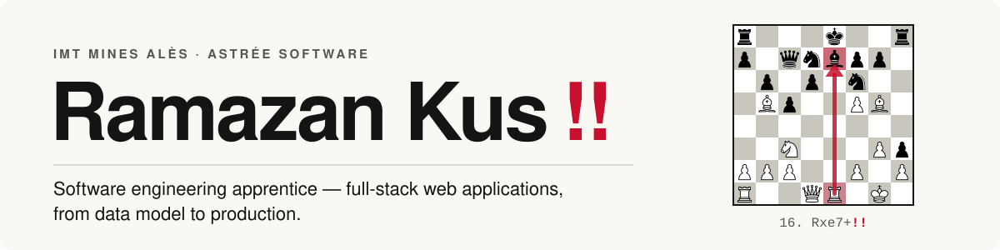

<a href="https://ramazankus.dev/en">
  <picture>
    <source media="(prefers-color-scheme: dark)" srcset="assets/banner-dark-v3.svg">
    
  </picture>
</a>

  
  
  
  

> **Open to a developer internship abroad — summer 2027, 9 weeks minimum, any country outside France (EU citizen).**

## About

- 🎓 Engineering student in Computer Science at **IMT Mines Alès** (work-study track, since 2025).
- 🏭 Apprentice developer at **Astrée Software** since 2024: client-specific features in Java, Spring and Angular for an MES, the software that runs production in a factory.
- 🧪 Before that, QA intern at the same company: test plans and end-to-end tests with Cypress.
- 🎓 BUT in Computer Science at IUT Lyon 1 (2022 – 2025).
- 🌍 French and Turkish (native), English (C1, TOEIC certified).
- 📂 A selection of my projects, told through the problem each one solves: [ramazankus.dev/en/projects](https://ramazankus.dev/en/projects).

## Stack

Every skill below is backed by a project or a job on [ramazankus.dev/en/skills](https://ramazankus.dev/en/skills).

| Domain | Tools |
| --- | --- |
| **Frontend** |  |
| **Backend** |  |
| **Data** |   |
| **Tools** |    |

## GitHub stats

  <picture>
    <source media="(prefers-color-scheme: dark)" srcset="https://github-readme-stats.vercel.app/api?username=Rameray1&count_private=true&show_icons=true&hide_border=true&bg_color=161513&title_color=ff5a6a&text_color=f1efea&icon_color=ff5a6a&rank_icon=percentile">
    
  </picture>
  <picture>
    <source media="(prefers-color-scheme: dark)" srcset="https://github-readme-stats.vercel.app/api/top-langs/?username=Rameray1&layout=compact&langs_count=6&hide_border=true&bg_color=161513&title_color=ff5a6a&text_color=f1efea">
    
  </picture>

  <picture>
    <source media="(prefers-color-scheme: dark)" srcset="https://streak-stats.demolab.com?user=Rameray1&hide_border=true&background=161513&ring=ff5a6a&fire=ff5a6a&currStreakNum=f1efea&sideNums=f1efea&currStreakLabel=ff5a6a&sideLabels=aaa69d&dates=aaa69d&stroke=36342f">
    
  </picture>

Most of my work happens in private client repositories, so these numbers show only part of it.

